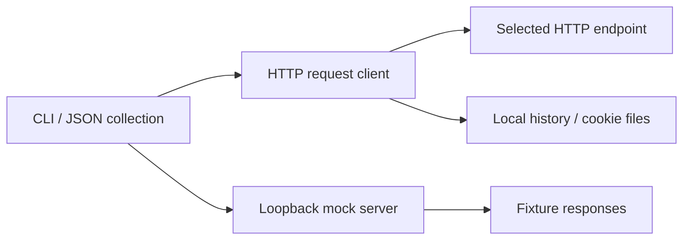

<p align="center"></p>
<h1 align="center">httpeek</h1>
<p align="center"><strong>Send API requests and serve local mocks from one terminal.</strong></p>

[](https://github.com/LucasXlab/httpeek/actions/workflows/ci.yml) [](LICENSE) [](https://github.com/LucasXlab/httpeek/blob/main/pyproject.toml)  [](https://github.com/LucasXlab/httpeek/stargazers)

[English](README.md) · [简体中文](README.zh-CN.md)


The demo is captured from the real CLI using synthetic data. [Transcript](demo/terminal.txt) · regenerate with `python3 scripts/demo.py`.

## Why

Keep an API request collection and its local mock routes in one JSON file. Send requests, replay a collection, or serve the same file locally without a project account or runtime dependencies.

| Start with | Good for | Where httpeek helps |
|---|---|---|
| One-off HTTP requests | Inspect a single response | httpeek also stores reusable JSON collections. |
| A separate mock server | Simulate an API locally | httpeek keeps request and mock definitions in one file. |

## Quick start

```bash
git clone https://github.com/LucasXlab/httpeek.git && cd httpeek
python3 -m pip install .
python3 scripts/demo.py
```

Install from this checkout to use the reviewed source version. The installed tool has no third-party runtime dependencies; cloning and installation can require network access.

## Features

### Send HTTP requests

GET/POST and other methods, headers, query parameters, JSON bodies and multipart forms.

### Keep collections

Save requests, import a subset of curl syntax, and run collections from a versionable JSON file.

### Mock locally

Serve fixture responses on loopback. These are intentionally simulated API responses, not a live upstream service.

### Reuse a session

Replay local history, export curl commands and load/save JSON cookie jars.


## Usage

```bash
httpeek init collection.json
httpeek mock collection.json --port 8080
# In another terminal:
httpeek get http://127.0.0.1:8080/hello --no-history
httpeek get https://example.com --to-curl
httpeek history
httpeek run collection.json
```

## Architecture



## Privacy and limits

HTTP requests send data to the URL you choose. History stores URLs, headers and text bodies locally by default, including possible credentials; use `--no-history` for sensitive requests and `httpeek history --clear` to remove history. Cookie jars and collections can contain secrets: never commit them. The optional `ai` command sends your prompt to its configured Ollama endpoint. See [PRIVACY.md](PRIVACY.md) for data boundaries.

## Development

```bash
python3 -m unittest discover -s tests -v
```

The demo uses a temporary fixture and does not inspect your personal repositories or agent homes.

## Roadmap

- [ ] Improve curl-import coverage and validation.
- [ ] Add sensitive-field controls for request history.

## Contributing

Read [CONTRIBUTING.md](CONTRIBUTING.md). Report reproducible problems in [Issues](https://github.com/LucasXlab/httpeek/issues). Follow [SECURITY.md](SECURITY.md) for sensitive reports.

## License

[MIT](LICENSE).
