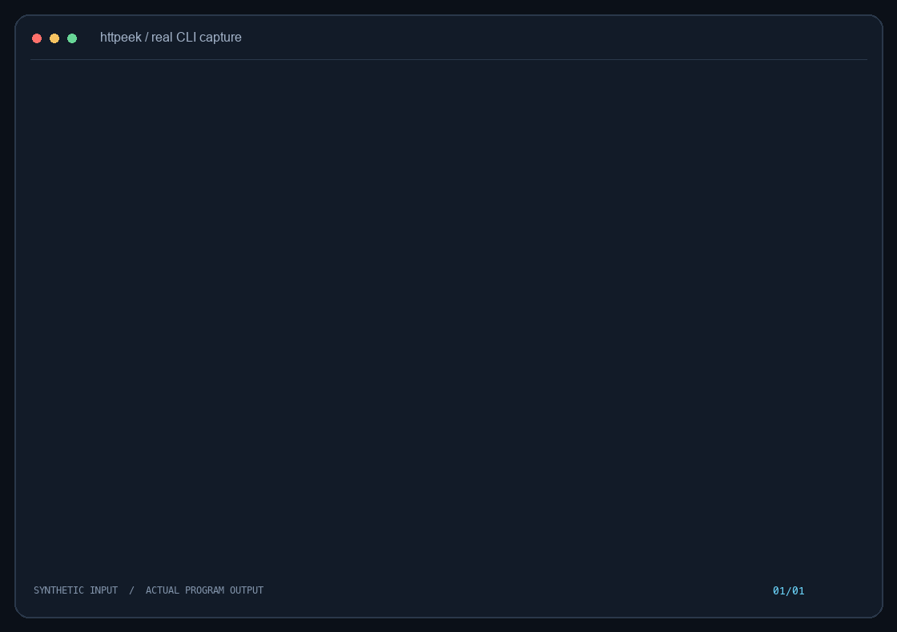
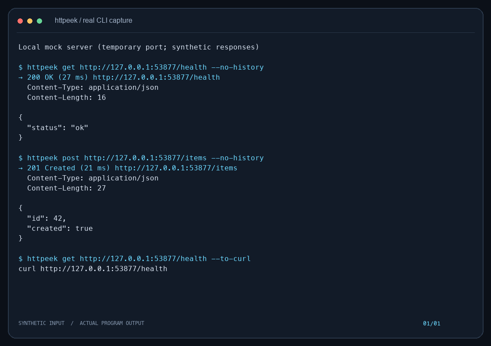
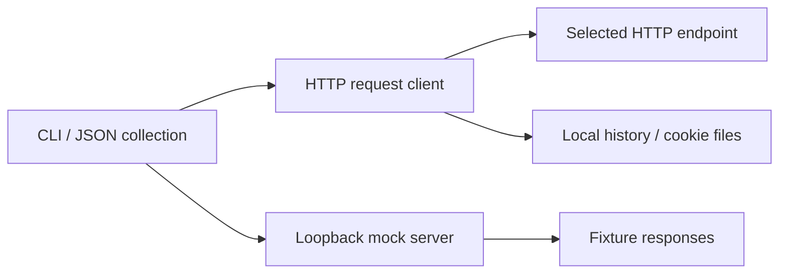

<p align="center"></p>
<h1 align="center">httpeek</h1>
<p align="center"><strong>在同一个终端发送 API 请求，并运行本地 Mock 服务。</strong></p>

[](https://github.com/LucasXlab/httpeek/actions/workflows/ci.yml) [](LICENSE) [](https://github.com/LucasXlab/httpeek/blob/main/pyproject.toml)  [](https://github.com/LucasXlab/httpeek/stargazers)

[English](README.md) · [简体中文](README.zh-CN.md)



演示来自真实程序输出，输入全部为合成数据。[终端记录](demo/terminal.txt)；运行 `python3 scripts/demo.py` 可复现。

## 为什么需要它

将 API 请求集合与本地 Mock 路由保存在一个 JSON 文件中；发送请求、执行集合、运行本地服务，都无需产品账号或第三方运行依赖。

## 快速开始

```bash
git clone https://github.com/LucasXlab/httpeek.git && cd httpeek
python3 -m pip install .
python3 scripts/demo.py
```

从当前检出目录安装即可运行已审阅的源码版本。安装后的工具无第三方运行依赖；克隆与安装过程仍可能需要联网。

## 功能

### 发送 HTTP 请求

支持多种方法、请求头、查询参数、JSON 请求体和 multipart 表单。

### 保存请求集合

将请求存成 JSON，导入部分 curl 语法，再按集合执行。

### 本地 Mock

在回环地址提供预设响应。Mock 是明确的模拟 API，不冒充真实上游服务。

### 复用会话

重放本地历史、导出 curl，并读写 JSON Cookie 文件。



## 使用

```bash
httpeek init collection.json
httpeek mock collection.json --port 8080
# In another terminal:
httpeek get http://127.0.0.1:8080/hello --no-history
httpeek get https://example.com --to-curl
httpeek history
httpeek run collection.json
```

## 架构



## 隐私与边界

HTTP 请求会将数据发往指定 URL。历史默认在本机保存 URL、请求头和文本请求体，可能包含凭据；敏感请求请用 `--no-history`，并用 `httpeek history --clear` 清理历史。Cookie 与请求集合也可能含密钥，不要提交到仓库。可选 `ai` 命令会将提示词发送到配置的 Ollama 端点。 详见 [PRIVACY.md](PRIVACY.md)。

## 开发与验证

```bash
python3 -m unittest discover -s tests -v
```

演示只使用临时样例，不会扫描你的个人仓库或代理主目录。

## 路线图

请参阅[英文路线图](README.md#roadmap)，其中只列出尚未实现的工作。

## 贡献与许可

贡献方式见 [CONTRIBUTING.md](CONTRIBUTING.md)，安全问题见 [SECURITY.md](SECURITY.md)。采用 [MIT License](LICENSE)。
